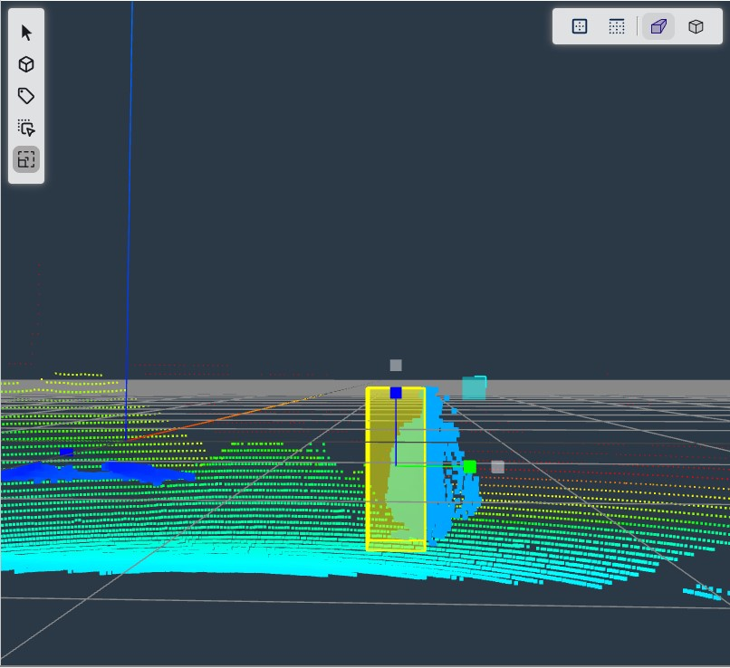
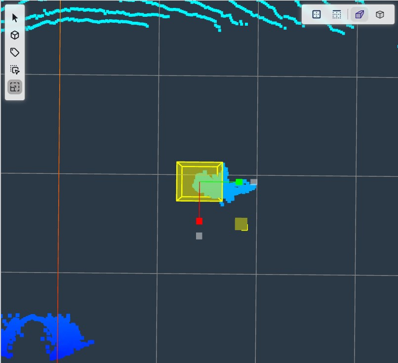
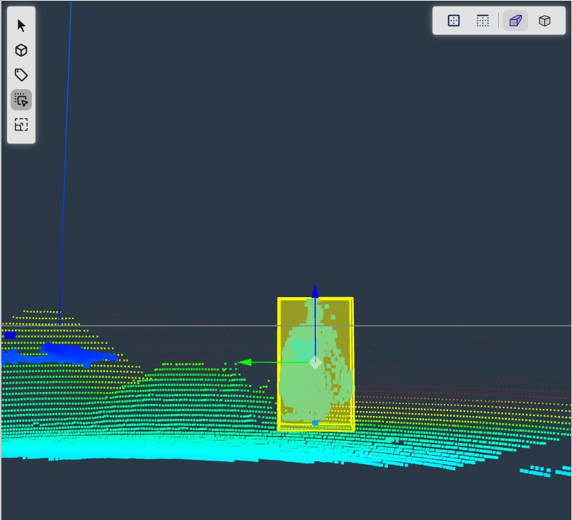
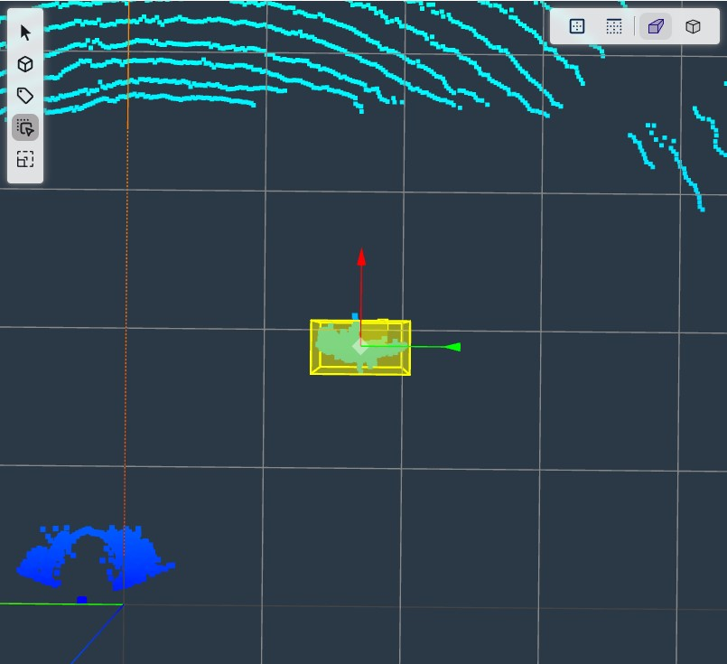
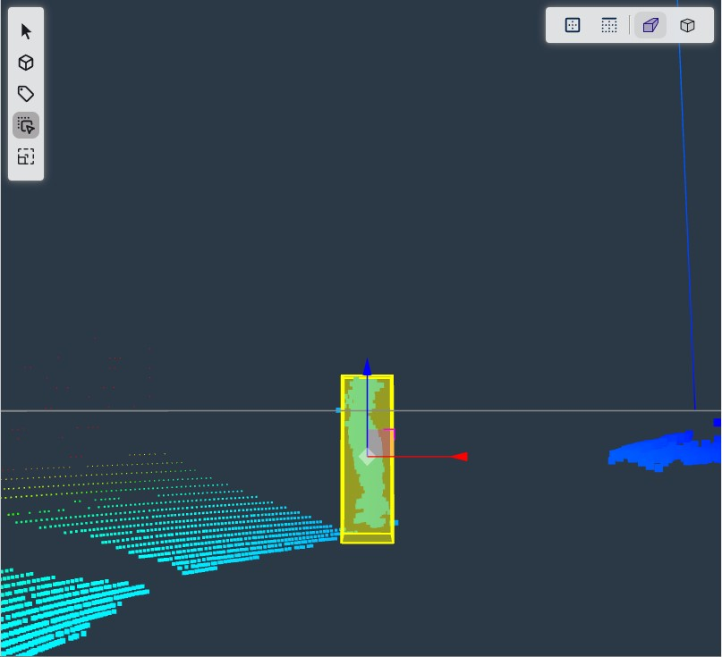

This section describes fine tuning adjustments to the 3D bounding boxes in the dataset; it describes how to add, translate, and scale 3D bounding boxes.

First [navigate to the dataset gallery](../../datasets/tutorials/management.md#view-dataset).  Ensure that the LiDAR and/or Radar point clouds, and the 3D bounding box annotations are toggled visible.

{{ figure("/3D/assets/pcd_visibility.jpg", "Visible 3D Annotations") }}

## Scale 3D Annotation

The error in the current annotation is that the bounding box is not scaled properly.  Click on the option on the left sidebar to enable 3D bounding box scaling as indicated in red.

{{ figure("/datasets/assets/annotations/manual/scale-3d-box.jpg", "Scale 3D Annotations") }}

Click on the current 3D bounding box to scale and this will provide anchor points to scale the 3D bounding box in the 3-axis.

{{ figure("/datasets/assets/annotations/manual/scale-3d-box-axis.jpg", "Scaling 3D Annotations") }}

Next adjust the scaling of the 3D bounding box in each axis by dragging the anchor points (red, green, blue).  The 3D bounding box shown below was adjusted with proper scaling to the LiDAR point clouds of the object.  

| Scaled YZ Plane             | Scaled XY Plane           | Scaled XZ             |
|-----------------------------|---------------------------|-----------------------|
|  |  |  |

However, the translation is still quite off, instructions to fix this issue will be shown in the next section.

## Translate 3D Annotation

Next the adjusted 3D bounding box needs to be properly translated.  Click on the option on the left sidebar to enable 3D bounding box translation as indicated in red.

{{ figure("/datasets/assets/annotations/manual/translate-3d-box.jpg", "Translate 3D Annotations") }}

Similar to the workflow as scaling the 3D bounding boxes above, move the three anchor points for each axis to translate the bounding box for each axis.

| Translate YZ Plane          | Translate XY Plane        | Translate XZ          |
|-----------------------------|---------------------------|-----------------------|
|  |  |  |

Once the 3D bounding box annotation is properly oriented, click "Save Image Annotations" or press "ENTER" on your keyboard to save the changes.

{{ figure("/datasets/assets/annotations/manual/submit-audit-3d-boxes.jpg", "Submit 3D Annotations") }}

## Add 3D Annotation

To add a missing 3D bounding box, click on the option on the left sidebar to add a new 3D bounding box annotation as indicated in red.

{{ figure("/datasets/assets/annotations/manual/add-3d-box.jpg", "Add 3D Annotations") }}

Now click on the grid to add a new 3D bounding box on the position of the click.

{{ figure("/datasets/assets/annotations/manual/added-3d-box.jpg", "Added 3D Annotations") }}

The added 3D bounding box may not be scaled or translated properly.  Follow instructions for [scaling](#scale-3d-annotation) and [translating](#translate-3d-annotation) a 3D bounding box to properly center the bounding box around the LiDAR point cloud as shown below.  Once the annotation is properly scaled and translated, click "Save Image Annotations" or press "ENTER" on your keyboard to save the annotation.

{{ figure("/datasets/assets/annotations/manual/submit-added-3d-box.jpg", "Submit 3D Annotations") }}

## Cluster 3D Annotation

The clustering tool creates a 3D bounding box around an object directly from the point cloud, which is faster than placing and scaling a box by hand.  It works on the visible LiDAR point cloud, or on the Radar point cloud when no LiDAR is visible.

A label must be selected before the tool can be used.  Click the **Clustering Mode** option on the left sidebar of the 3D canvas, or press the `C` key.

{{ figure("/datasets/assets/annotations/manual/clustering-tool-button.jpg", "3D canvas left sidebar with the Clustering Mode button") }}

If an object already exists. i.e. you would like to tie the 3D bounding box to an existing 2D annotation, select the object by clicking on the annotated object on the frame or press the "down arrow" key to toggle between objects.

{{ figure("/datasets/assets/annotations/manual/select-annotated-object.jpg", "Select Annotated Object") }}

Then drag a rectangle on the 3D canvas around the LiDAR/Radar PCD clusters representing the object.  A dashed rectangle shows the selected region.

{{ figure("/datasets/assets/annotations/manual/clustering-drag-region.jpg", "Dashed selection rectangle drawn around the points of a vehicle in the 3D canvas") }}

When the mouse is released, the points inside the region are grouped into clusters of nearby points and a 3D bounding box is created around the **largest cluster**.  The new box uses the selected label.  Points of other objects that happen to fall inside the region are ignored as long as they form a smaller cluster.

{{ figure("/datasets/assets/annotations/manual/clustering-result.jpg", "The 3D bounding box created around the cluster after releasing the mouse") }}

A few points to keep in mind:

* Two points belong to the same cluster when they are within 0.5 m of each other for LiDAR, or 1.0 m for Radar.
* The region must be at least 5x5 pixels.  A single click only selects the box under the pointer.
* If the region does not contain any points, a warning is shown and no box is created.
* Only a 3D box is created, with a minimum size of 0.1 m in each axis.  Adjust it with the [scale](#scale-3d-annotation) and [translate](#translate-3d-annotation) tools if needed.
* If an object is selected when the box is created, the box is added to that object, the same as the 3D box tool.  See [Objects and Annotation Cases](../../3D/annotations/cases.md).

Click "Save Image Annotations" or press "ENTER" on your keyboard to save the new annotation.

## Delete 3D Annotation

To delete only a 3D box, expand the object in the **Annotations** panel and click the delete button for that annotation type. The object's other annotations are kept. Selecting the object and pressing `Delete` on your keyboard, or clicking **Delete Object**, deletes the entire object and all of its annotations.

{{ figure("/datasets/assets/annotations/manual/deleted-3d-annotation.jpg", "Delete 3D Annotations") }}

Click "Save Image Annotations" or press "ENTER" on your keyboard to save the changes.
