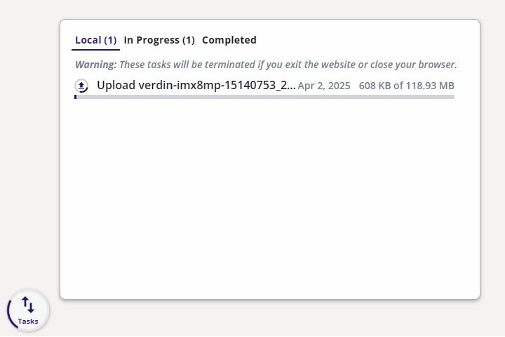
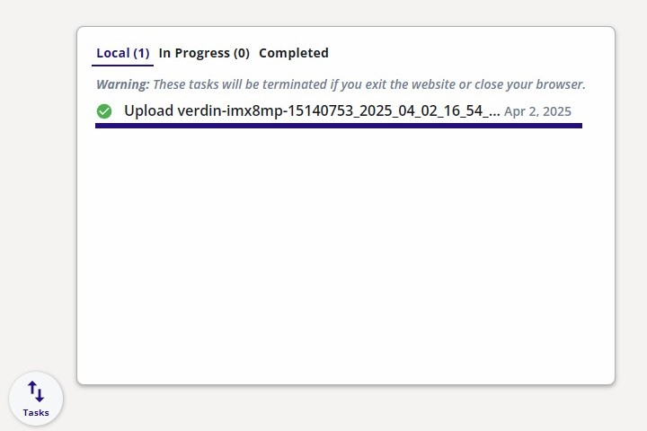

# Upload MCAP

There are two ways of uploading an MCAP into EdgeFirst Studio:

1. From the Maivin/Raivin device
2. From EdgeFirst Studio

## From the Maivin/Raivin

Click the "Upload" button  in the row containing the name of the MCAP file you want to upload to EdgeFirst Studio, which will bring you to the upload MCAP modal. In this modal, provide your login information to upload the MCAP file to your EdgeFirst Studio account.

{{ figure("/platforms/assets/setup/upload_mcap_modal.png", "Upload MCAP Modal") }}

Once logged in, upload the MCAP by clicking the "Upload" button as shown.

{{ figure("/platforms/assets/setup/upload_mcap_button.png", "Upload MCAP Button") }}

Once the upload completes, a similar indication should be shown below.

{{ figure("/platforms/assets/setup/upload_mcap_complete.png", "Upload MCAP Completed") }}

The MCAP should be available in {{ studio_link("EdgeFirst Studio") }} as a snapshot.

{{ figure("/platforms/assets/setup/studio_uploaded_mcap.jpg", "Uploaded MCAP as a Snapshot in EdgeFirst Studio") }}

## From EdgeFirst Studio

To upload an MCAP Recording into EdgeFirst Studio, first {{ studio_link("login", "login") }} to EdgeFirst Studio.  Once logged in to EdgeFirst Studio, navigate to the "Data Snapshots" under the apps menu.

{{ figure("/datasets/assets/annotations/automatic/data-snapshots.jpg", "Data Snapshots") }}

Once you are in the "Data Snapshots" page, upload the recorded MCAP by clicking "From File" which opens a new window dialog for selecting the MCAP downloaded in your PC.

!!! note "EdgeFirst Datasets"
    You can also drag and drop [EdgeFirst Datasets](../../datasets/format/index.md) ZIP and Arrow files in the "Data Snapshots".

{{ figure("/datasets/assets/capture/mcap-upload.jpg", "Upload MCAP") }}

Once the MCAP file is selected, this would start the upload progress in EdgeFirst Studio.  This upload progress may take several minutes depending on the size of the MCAP. Once the upload is complete, the status will be shown like the figure on the right.

**Upload Progress** | **Completed Upload**
:------------------:|:------------------:
 | 
