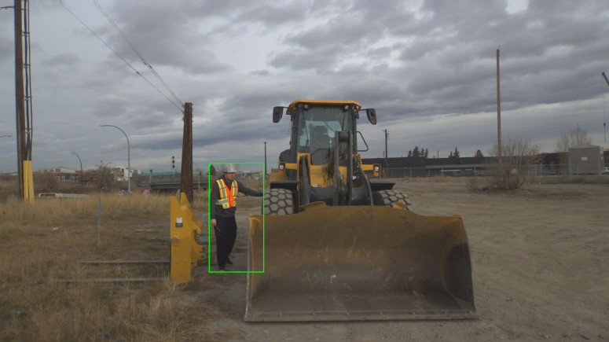
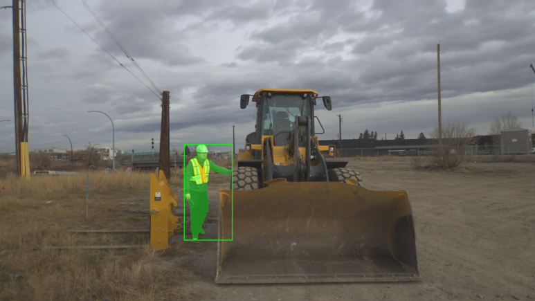

# ModelPack Overview

ModelPack is an advanced computer vision solution developed by Au-Zone Technologies as part of their EdgeFirst.AI middleware. It provides both object detection and semantic segmentation capabilities, enabling high-performance, low-latency AI inference on embedded devices, particularly those with AI accelerators (NPUs) in the 0.5 TOPS and up range.

| Detection                   | Segmentation                | Multitask                     |
|-----------------------------|-----------------------------|-------------------------------|
|  |  |  |

ModelPack is optimized for real-time vision applications such as industrial automation, robotics, and autonomous systems. It combines object detection — locating multiple objects within an image using bounding boxes — with instance segmentation, which outlines each object’s exact shape at the pixel level. This unified approach enables detailed scene understanding at the edge and can contribute in a late fusion with the radar model.

## Getting Started

ModelPack can be trained in {{ studio_link("EdgeFirst Studio") }} by following four simple steps:

=== "Select Framework"

    <h2 id="select-framework" style="display: none;"></h2>

    1. Select **ModelPack** within the available training frameworks.

    {{ img("../assets/modelpack/modelpack-train-01.jpg", "Select ModelPack Training Framework") }}{ align=center }

    

    [Next → 2. Name Session](#name-session){ .md-button .md-button--primary }
    

=== "Name Session"

    <h2 id="name-session" style="display: none;"></h2>

    2. Set a **name** and **description** *(optional)* for the training session.

    {{ img("../assets/modelpack/modelpack-train-02.jpg", "Set Name and Description") }}{ align=center }

    

    [1. Select Framework ← Back](#select-framework){ .md-button }
    [Next → 3. Select Dataset](#select-dataset){ .md-button .md-button--primary }
    

=== "Select Dataset"

    <h2 id="select-dataset" style="display: none;"></h2>

    3. Choose your **dataset**.

    {{ img("../assets/modelpack/modelpack-train-03.jpg", "Select a Dataset") }}{ align=center }

    

    [2. Name Session ← Back](#name-session){ .md-button }
    [Next → 4. Configure & Train](#train){ .md-button .md-button--primary }
    

=== "Train"

    <h2 id="train" style="display: none;"></h2>

    4. **[Configure the launch form](#training-parameters)** (input, model, training, augmentation and export) and start the session.

    {{ img("../assets/modelpack/modelpack-train-04.jpg", "Configure and Train") }}{ align=center }

    

    [3. Select Dataset ← Back](#select-dataset){ .md-button }
    [Next → 5. Validate](../validation/vision/managed.md){ .md-button  .md-button--primary }
    

=== "Training Parameters"

    <h2 id="training-parameters" style="display: none;"></h2>

    The ModelPack launch form groups its fields as follows.

    1. **Training Session**
        1. **Name**: The name of the training session, also used to name the artifacts (e.g. `modelpack-coffeecup-640x640-rgb-t-<session ID>.fp32.onnx`)
        2. **Description**: An optional description of the training session, commonly used to highlight some parameters
    2. **Source Dataset**: The dataset the session trains, validates and calibrates on, with its annotation set and tag.  The dataset can belong to a different project than the experiment
    3. **Destination Experiment**: The experiment the training session is created in.  Its artifacts and charts are published there when the session finishes
    4. **Input**
        1. **Input Resolution**: The network input resolution (width x height), 480x270 by default.  The options are 320x320 and 640x640 (1:1); 320x180, 480x270, 640x360, 960x540, 1280x720, 1920x1088, 2560x1440 and 3840x2176 (16:9); and 640x480, 1024x768 and 2592x1944 (4:3).  1920x1088 and 3840x2176 are 1080p and 4K with the height rounded up to the network stride of 32.  Pick the resolution closest to your deployment camera.  Higher resolutions need more GPU memory; see **Batch Size**.  With [Input Tiling (SAHI)](#input-tiling-sahi) the Input Resolution is the tile size
        2. **Camera Adaptor**: The target camera format of the model input, one of RGB (default), BGR, RGBA, BGRA, Greyscale or YUYV.  See [Camera Adaptor and Letterbox](#camera-adaptor-and-letterbox)
        3. **Input Tiling (SAHI)**: Off by default.  Trains on native-resolution tiles of each image.  The tiling settings and **Tiled Validation** that follow it configure the tiles.  See [Input Tiling (SAHI)](#input-tiling-sahi)
        4. **Letterbox Resize**: On by default.  Resizes each image into the model input while preserving its aspect ratio.  Ignored with Input Tiling, which always letterboxes.  See [Camera Adaptor and Letterbox](#camera-adaptor-and-letterbox)
    5. **Model Parameters**: Configures the model architecture and the tasks to train.  These fields are ignored when the **Weights** are a previous training session, except that selecting **Segmentation** with weights that have no segmentation head fails the session
        1. **Model Backbone**: CSPDarkNet19 (default), optimized for inference time, or CSPDarkNet53, optimized for accuracy
        2. **Model Size**: Nano (default), Small, Medium or Large.  Similar to modern architectures, ModelPack scales the channel width and the block depth with the size (width `0.25`, `0.375`, `0.5`, `0.75` and depth `0.33`, `0.33`, `0.33`, `0.67` from Nano to Large)
        3. **Activation Function**: The main activation used in the model, one of ReLU, ReLU6 (default) and SiLU.  ReLU6 produces the best tradeoff between speed and accuracy in most cases
        4. **Object Detection**: Trains an object detection model (enabled by default)
        5. **Segmentation**: Trains a semantic segmentation model.  Selecting both **Object Detection** and **Segmentation** produces a multitask model with one output per task
        6. **Focus Input**: Off by default.  Reshapes the input as a 2x2 patch grid before the first convolution, trading per-pixel processing for a higher channel count at half resolution.  This is often a small inference speedup on NPUs, with a possible accuracy cost on very small objects
        7. **Fine Detection Head**: Off by default.  Adds a stride-8 (P3) detection head so small objects, below 32 pixels, have enough feature cells to localize.  Recommended together with Input Tiling.  It applies to CSPDarkNet19; CSPDarkNet53 always has the stride-8 head
    6. **Training Parameters**
        1. **Weights**: The weights the session starts from, either **Default Weights** (default) or the `.keras` weights published by a previous ModelPack training session.  See [Weights Source](#weights-source)
        2. **Enable Training**: On by default.  Turn it off to export the selected **Weights** without retraining, for example to re-export tile-trained weights at another resolution.  See [Weights Source](#weights-source).  The following fields appear when **Enable Training** is on

            1. **Epochs**: The number of epochs to train the model, 50 by default (1 to 500)
            2. **Batch Size**: The number of samples (tiles, with Input Tiling) processed in a single training step, 16 by default (1 to 64).  The larger the input resolution, the smaller the batch that fits in GPU memory.  When the batch does not fit, the trainer reduces it and accumulates gradients over several steps so that the effective batch size stays close to the Batch Size

    7. **Data Augmentation**: The probability of each augmentation technique, in percent.  Augmentation is crucial for training models and reducing overfitting, especially on small datasets.  The augmentations are turned off for the final 10% of the epochs.  See [Vision Augmentations](../augmentations.md)
        1. **Random Brightness and Contrast**: 50 by default
        2. **Random HSV**: Random hue, saturation and value, 30 by default
        3. **Random Grayscale**: 10 by default
        4. **Random Horizontal Flip**: 50 by default
        5. **Random Vertical Flip**: 0 by default.  A vertical mirror is not label-preserving for ground-referenced scenes; enable it for overhead or aerial imagery
        6. **Random Shift and Scale**: 25 by default.  Not used with Input Tiling
        7. **Random Mosaic**: 25 by default.  With Input Tiling, four tiles are combined at native scale
        8. **Mosaic Center Jitter**: 0 by default (0 to 0.45).  The half-range for randomizing the center point of a mosaic, as a fraction of the tile size.  0 keeps the fixed-center 2x2 mosaic layout; higher values vary the size of each quadrant.  It has an effect only when **Random Mosaic** is above 0, and none with Input Tiling
    8. **Export Parameters**: The session publishes the `.keras` weights, FP32 and FP16 ONNX models, a TensorFlow SavedModel, `labels.txt` and an INT8 calibration snapshot.  The [converter apps](../conversion/index.md) use them to produce INT8 quantized models for each target NPU
        1. **Calibration Samples**: The number of images (tiles, for a tiled model) in the INT8 calibration snapshot, 500 by default (100 to 2000).  Very low counts can reduce quantized accuracy.  Snapshots are reused across sessions with matching settings
        2. **ONNX Opset Version**: The ONNX opset version of the exported model, 11, 12 or 13 (default).  Keep the default unless a downstream tool requires an older version
        3. **Deployment**: **Tiled** (default) or **Whole frame**.  Applies only to export-only sessions whose **Weights** were trained with Input Tiling, and is ignored for every other session.  See [Deploying Tile-Trained Models](#deploying-tile-trained-models)
    9. **Start App**: This button starts the training session

## Camera Adaptor and Letterbox

The **Camera Adaptor** dropdown in the Input group selects the target camera format of the model input.  Select the format that matches your deployment camera or ISP output to avoid runtime color conversions.  See [Camera Adaptor](../cameraadaptor.md) for the supported formats and platform guidance.

The photometric augmentations depend on the format.  **Random Brightness and Contrast** applies to RGB, BGR and Greyscale; **Random HSV** and **Random Grayscale** apply to RGB and BGR only.  The RGBA, BGRA and YUYV formats receive the geometric augmentations only.

When the **Weights** are a previous training session, the camera adaptor comes from those weights and the dropdown is ignored.

**Letterbox Resize** fits each image into the model input with an aspect-preserving letterbox: the image is scaled to fit, centred, and padded with gray (114).  Boxes are remapped into the padded image, and segmentation masks are padded with the background class.  Leave it on for general datasets.  For fixed-camera datasets whose frames already match the input aspect ratio it has no effect and can be turned off, which resizes the image directly to the model input and skips the padding.

The resize mode is recorded in the [model metadata](../metadata.md) so deployment runtimes preprocess identically, and the calibration snapshot uses the same resize mode, so INT8 calibration sees the deployment input.

## Weights Source

The **Weights** field in the Training Parameters group selects the weights a session starts from.

- **Default Weights** (default) start from the COCO-pretrained detection weights bundled for the selected backbone and size (CSPDarkNet19 Nano, Small and Large; CSPDarkNet53 Nano and Small), and from the ImageNet-pretrained backbone for the other combinations, except CSPDarkNet53 Large, which trains from scratch.  Layers whose shape depends on the dataset, such as the class outputs, start fresh, and the anchors are fit to the dataset.
- **A previous training session** uses the `.keras` weights published by a ModelPack training session together with the model definition embedded in them.  The backbone, size, activation, focus input, fine head, tasks, anchors and camera adaptor come from the weights, so the **Model Parameters** and the **Camera Adaptor** on the form are ignored.  The weights' classes must equal the dataset's classes, in the same order; otherwise the session fails before it downloads the dataset.

The **Enable Training** setting then decides what the session does with the weights.

| Weights | Enable Training | Session behavior |
|---------|-----------------|------------------|
| Default Weights | On | **Default.** Trains a new model on the selected dataset. |
| A previous training session | On | Fine-tunes that session's weights on the selected dataset. |
| A previous training session | Off | No training.  Exports that session's weights at the Input Resolution, and for tile-trained weights at the **Deployment** chosen on the form.  See [Deploying Tile-Trained Models](#deploying-tile-trained-models). |
| Default Weights | Off | Not supported.  The session fails, because there are no trained weights to export. |

A session with **Enable Training** off rounds the Input Resolution up to a multiple of 32, which the exported model requires (480x270 exports as 480x288, with the letterbox padding the difference).  It validates the exported model on the dataset's validation split and reports the results as its final validation metrics.  It runs no epochs, so its loss and learning-rate charts stay empty.

## Input Tiling (SAHI)

Small objects in high-resolution images lose most of their pixels when the image is downscaled to the model's input size.  **Input Tiling (SAHI)** trains on native-resolution tiles of each image instead of downscaling the whole image, so small objects keep their native pixel scale.  See [Training for Small Objects (SAHI)](../training/sahi.md) for when to use it and how to deploy the result.

With Input Tiling enabled, the **Input Resolution** is the tile size; 640x640 is the preferred choice, together with the **Fine Detection Head**.  Input Tiling supports object detection with the **RGB** or **BGR** camera adaptor; a session that also selects **Segmentation**, or another camera adaptor, fails at launch.

The following settings, in the Input group, control how tiles are sampled.  Their defaults are the validated recipe.

| Setting | Default | Description |
|---------|---------|-------------|
| **Frames per Batch** | 4 (1 to 16) | Images each training batch is drawn from.  Each image contributes about Batch Size ÷ Frames per Batch tiles, and every image is visited once per epoch.  Values above the Batch Size use the Batch Size. |
| **Background Tiles (%)** | 15 (0 to 50) | Percentage of tiles that contain no annotated object.  Lower it for densely annotated datasets. |
| **Full-Image Tiles (%)** | 10 (0 to 50) | Percentage of tiles that show the whole image fitted into the tile, keeping large objects and scene context.  The remaining tiles are placed around objects. |
| **Grid-Aligned Tiles (%)** | 25 (0 to 100) | Percentage of object and background tiles taken from the deployment tile grid, so the model sees the tile edges it meets at inference. |
| **Native-Scale Tiles (%)** | 50 (0 to 100) | Percentage of tiles cropped at exactly the deployment scale.  The rest are zoomed within the **Tile Zoom Range**. |
| **Tile Zoom Range** | 1.33 (1.0 to 2.0) | Largest zoom applied to non-native tiles, in and out equally: 1.33 samples between 0.75x and 1.33x.  1.0 disables zoom. |
| **Minimum Visible Fraction** | 0.25 (0.05 to 0.9) | An object cut by a tile edge is kept as a target only when at least this fraction of its area is inside the tile. |
| **Final Native Epochs** | 10 (0 to 50) | Closing epochs trained on native-scale tiles only, with the tile mosaic off, to match deployment.  Limited to half of the epochs. |
| **Class-Balanced Tiles** | Off | Places more tiles around objects of rare classes. |
| **Tiled Validation** | Whole Image | How validation scores the model on full images.  See [Tiled Validation](#tiled-validation). |

A tile smaller than the Input Resolution, such as a full-image tile or a tile cut from an image smaller than the tile, is letterboxed, centred, into it.  With Input Tiling, **Random Mosaic** combines four tiles at native scale and **Random Shift and Scale** is not used, because the tile sampler applies its own zoom.  The anchors are fit to the boxes as they appear in the tiles.

### Tiled Validation

A tile-trained model is scored on full images rather than per tile.  **Tiled Validation** selects how.

| Tiled Validation | Description |
|------------------|-------------|
| **Whole Image** (default) | Each full image runs through the model in one pass at native resolution, padded onto a canvas the size of the largest validation image.  This measures the accuracy of a [whole-frame deployment](../training/sahi.md#whole-frame-re-export) of the same weights. |
| **Tile Grid** | Each image is cut into the deployment tile grid, an evenly distributed grid with at least 10% overlap between tiles.  Each tile is detected separately, and the detections are lifted to image coordinates and merged across tiles.  This measures the accuracy of a [tiled deployment](../training/sahi.md#online-tiling), the deployment a tile-trained session exports. |
| **Both** | Runs both and reports the tile grid metrics alongside the whole-image metrics, with a `tiled_` prefix.  This is slower. |

Validation reports precision (`p`), recall (`r`), `map_0.5`, `map_0.5:.95` and, for tile-trained detectors, `map_0.5_single`, the mAP at IoU 0.5 with one class per box as the deployment decoder produces.

### Deploying Tile-Trained Models

A training session with Input Tiling exports a **tiled** model at the tile size.  Its [model metadata](../metadata.md#tiling) carries a `tiling` section describing the deployment tile grid and the merge of detections across tiles, so the runtime cuts each frame into tiles of the Input Resolution.  The calibration snapshot holds deployment-grid tiles rather than whole images; see [Tiled Models](../conversion/calibration.md#tiled-models).

The same weights can be deployed at another geometry without retraining by starting an export-only session: set **Weights** to the tile-trained session, turn **Enable Training** off, and choose the **Deployment** and **Input Resolution**.

| Deployment | Input Resolution is | Runtime behavior |
|------------|---------------------|------------------|
| **Tiled** (default) | The tile size. | The runtime cuts each frame into tiles of this size. |
| **Whole frame** | The model input, for example `3840x2176` for 4K frames. | The runtime letterboxes each frame into the model input once. |

!!! warning "ModelPack and Ultralytics default to different Deployment modes"
    The **Deployment** default is **Tiled** in ModelPack and **Whole frame** in Ultralytics.  To re-export ModelPack weights for whole-frame deployment, select **Whole frame** explicitly.

See [Training for Small Objects (SAHI)](../training/sahi.md#deploying-a-tile-trained-model) for the step-by-step workflow and how to choose between the two.

## ModelPack Architecture

ModelPack is a modern object detector and it adopts similar scaling strategies seen in the YOLO family models.
The model expands and contracts based on the width and height parameters.
ModelPack shares two main backbones: a Darknet53 backbone similar to [YOLOx](https://arxiv.org/pdf/2107.08430v2) which maximizes accuracy and a Darknet19 backbone for boosting inference time.
Different than YOLOx, ModelPack is NOT anchor free, which makes the model more accurate and stable after quantization.

{{ figure("../assets/darknet-53-backbone.png", "Darknet-53 Backbone") }}

Figure reproduced from: [Yang, L., Chen, G. & Ci, W. Multiclass objects detection](https://asp-eurasipjournals.springeropen.com/articles/10.1186/s13634-023-01045-8)

As mentioned above, ModelPack merges Semantic Segmentation and Object Detection on the same model and it is user responsibility depending on problem requirements.  Semantic Segmentation only uses two scales (Scale 1 and Scale 2). On the other hand, Object Detection task uses the three scales.

While solving both tasks in the same inference cycle, the three scales are used.

{{ figure("../assets/modelpack-arch.png", "ModelPack Architecture") }}

ModelPack outputs are configured in the [launch form](#training-parameters) of the training session.  See [Training Vision Models](../training/vision.md) for the training workflow.
