# Edge Platforms

*Explore the complete dataset-to-deployment lifecycle within your platform.*

=== "NXP i.MX"

    **Choose Your Vendor**{ .ef-tab-title }

    Select the vendor of your i.MX hardware to see the supported platforms.

    === "NXP"

        **Choose Your Platform**{ .ef-tab-title }

        Select the platform provided by NXP.

        **[i.MX 8M Plus](quickstart/nxp_imx/nxp/imx8mplus/index.md)** | **[FRDM i.MX 8M Plus](quickstart/nxp_imx/nxp/frdm_imx8mplus/index.md)**
        :-----------------------------:|:----------------------------: 
        [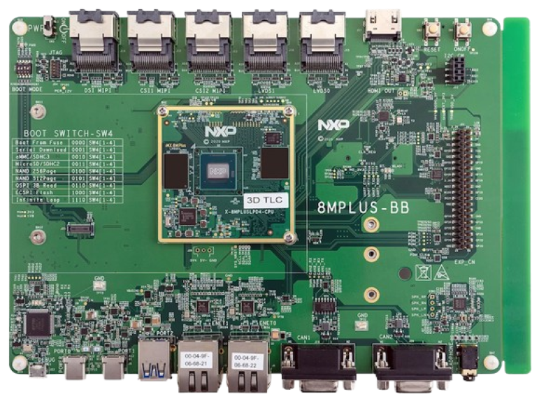](quickstart/nxp_imx/nxp/imx8mplus/index.md) | [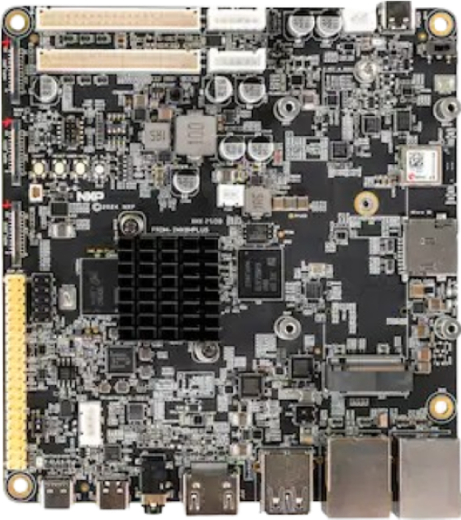](quickstart/nxp_imx/nxp/frdm_imx8mplus/index.md)

        **[i.MX 95](quickstart/nxp_imx/nxp/imx95/index.md)** | **[FRDM i.MX 95](quickstart/nxp_imx/nxp/frdm_imx95/index.md)**
        :-----------------------------:|:----------------------------:
        [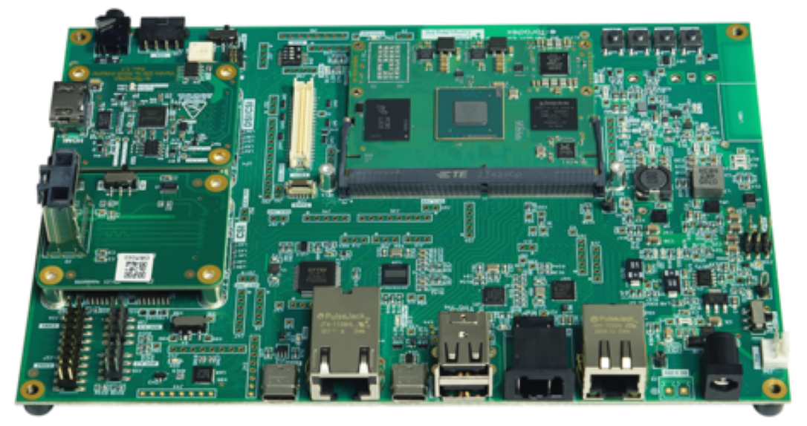](quickstart/nxp_imx/nxp/imx95/index.md) | [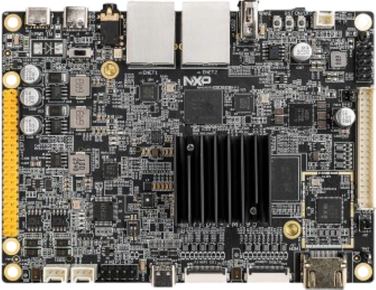](quickstart/nxp_imx/nxp/frdm_imx95/index.md)
    
    === "Au-Zone Technologies"

        **Choose Your Platform**{ .ef-tab-title }

        Select the platform provided by us.

        **[Maivin](quickstart/nxp_imx/auzone/maivin/index.md)** | **[Raivin](quickstart/nxp_imx/auzone/raivin/index.md)** 
        :-----------------------------:|:----------------------------: 
        [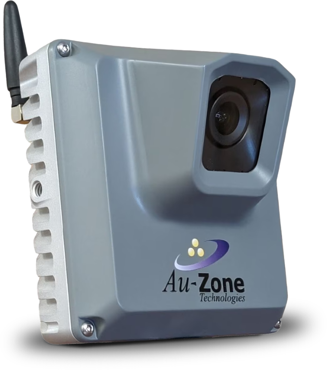](quickstart/nxp_imx/auzone/maivin/index.md) | [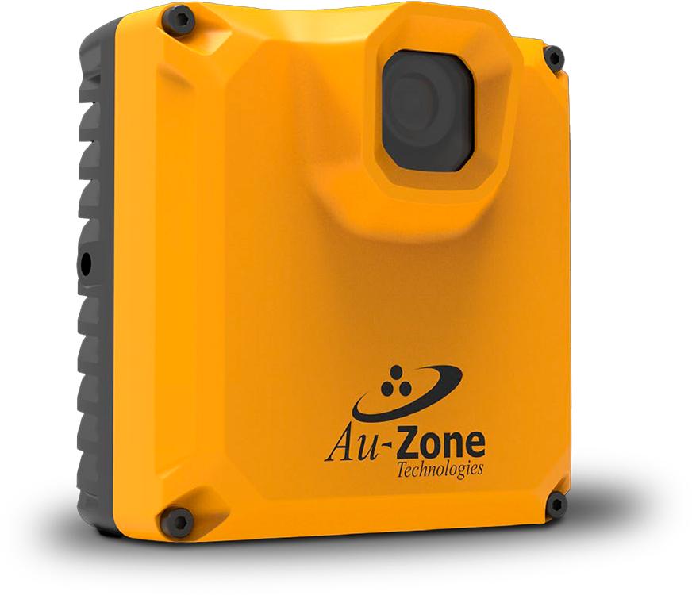](quickstart/nxp_imx/auzone/raivin/index.md)
        **Vision-Only Configuration** | **Combined Vision and Radar/LiDAR Configuration**

    === "PHYTEC"

        **Choose Your Platform**{ .ef-tab-title }

        Select the platform provided by PHYTEC.

        **[phyFLEX Libra i.MX 8M Plus](quickstart/nxp_imx/phytec/phyflex_libra_imx8mplus/index.md)** | **[phyFLEX Libra i.MX 95](quickstart/nxp_imx/phytec/phyflex_libra_imx95/index.md)** 
        :-----------------------------:|:----------------------------: 
        [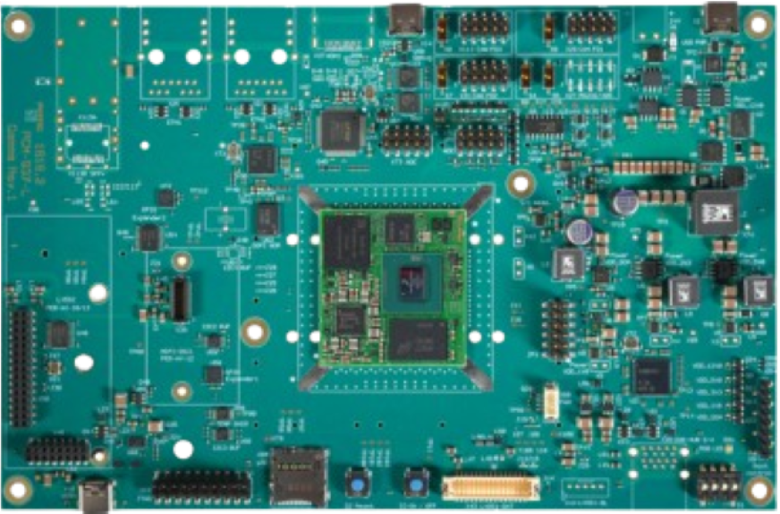](quickstart/nxp_imx/phytec/phyflex_libra_imx8mplus/index.md) | [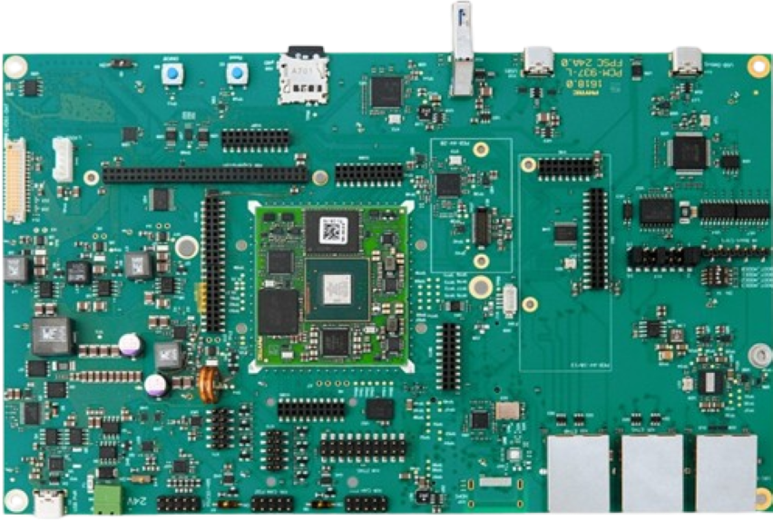](quickstart/nxp_imx/phytec/phyflex_libra_imx95/index.md)

        **[phyBOARD-Pollux i.MX 8M Plus](quickstart/nxp_imx/phytec/phyboard_pollux_imx8mplus/index.md)** | **[phyVIP i.MX 8M Plus](quickstart/nxp_imx/phytec/phyvip_imx8mplus/index.md)**
        :-----------------------------:|:----------------------------:
        [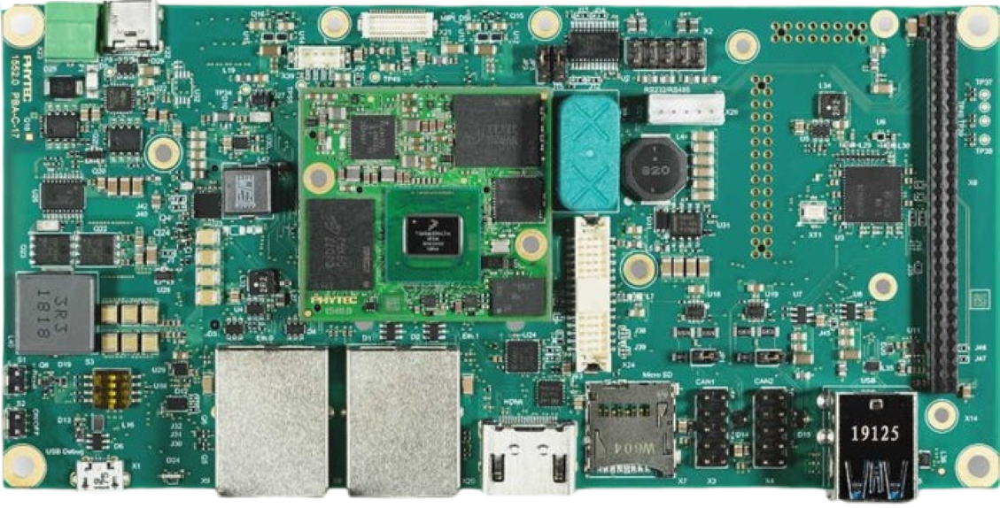](quickstart/nxp_imx/phytec/phyboard_pollux_imx8mplus/index.md) | [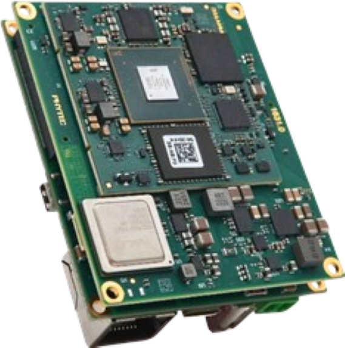](quickstart/nxp_imx/phytec/phyvip_imx8mplus/index.md)

    === "Ezurio"

        **Choose Your SOM**{ .ef-tab-title }

        Select the SOM provided by Ezurio.

        **[Nitrogen8M Plus SMARC](quickstart/nxp_imx/ezurio/nitrogen8mplus_smarc/index.md)** | **[Nitrogen95 SMARC](quickstart/nxp_imx/ezurio/nitrogen95_smarc/index.md)** 
        :-----------------------------:|:----------------------------: 
        [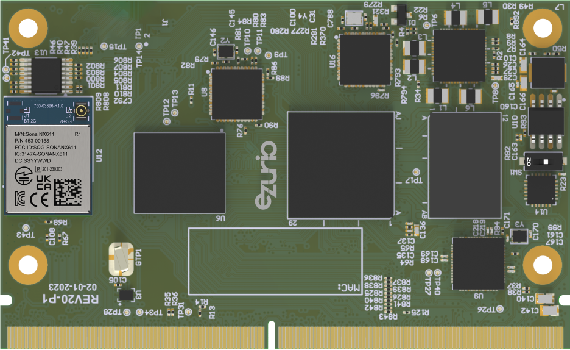](quickstart/nxp_imx/ezurio/nitrogen8mplus_smarc/index.md) | [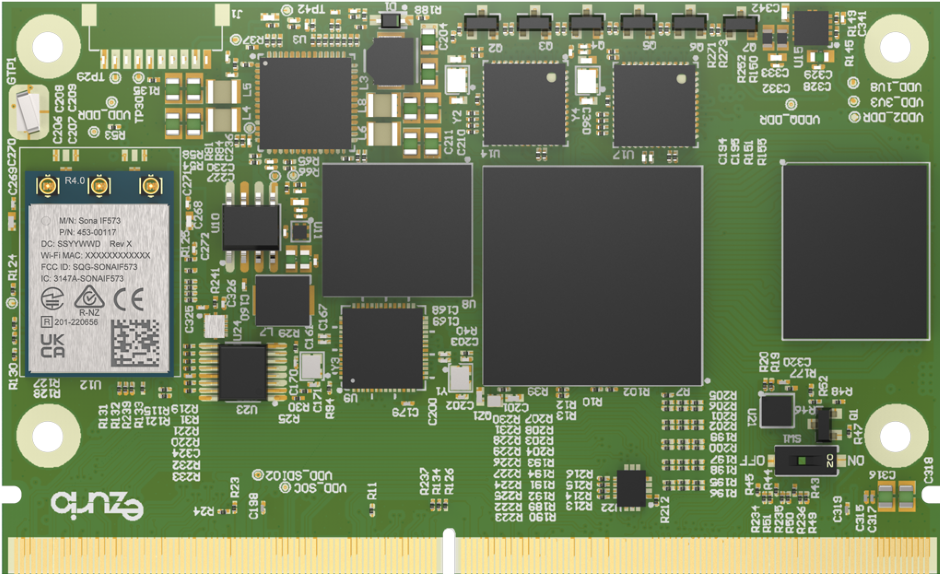](quickstart/nxp_imx/ezurio/nitrogen95_smarc/index.md)

    === "Toradex"

        **Choose Your SOM**{ .ef-tab-title }

        Select the SOM provided by Toradex.

        **[Verdin iMX8M Plus](quickstart/nxp_imx/toradex/verdin_imx8mplus/index.md)** | **[Verdin iMX95](quickstart/nxp_imx/toradex/verdin_imx95/index.md)** 
        :-----------------------------:|:----------------------------: 
        [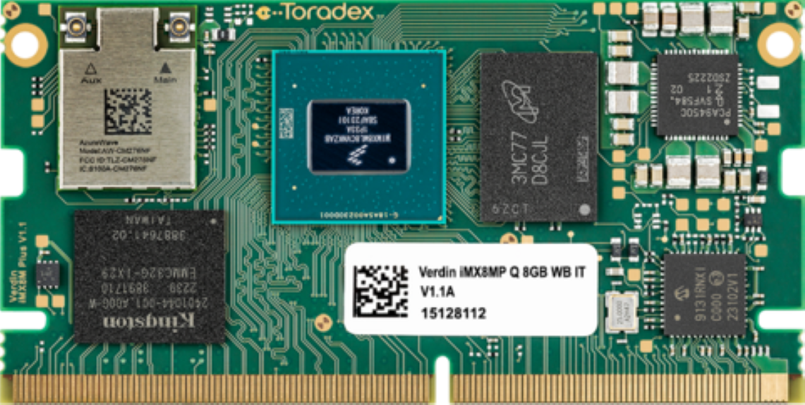](quickstart/nxp_imx/toradex/verdin_imx8mplus/index.md) | [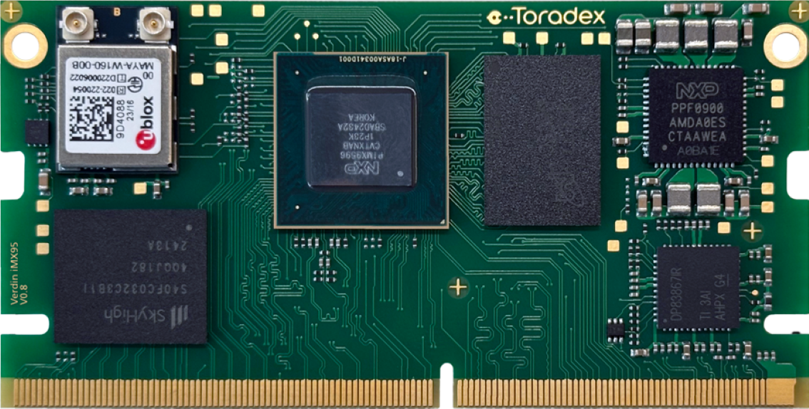](quickstart/nxp_imx/toradex/verdin_imx95/index.md)

=== "NVIDIA Jetson"

    **Choose Your Platform**{ .ef-tab-title }

    Select the platform provided by NVIDIA.

    **[Jetson Orin Nano](quickstart/nvidia_jetson/jetson_orin_nano/index.md)** | **[Jetson AGX Xavier](quickstart/nvidia_jetson/jetson_agx_xavier/index.md)** 
    :-----------------------------:|:----------------------------: 
    [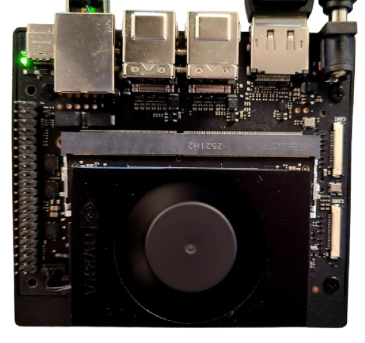](quickstart/nvidia_jetson/jetson_orin_nano/index.md) | [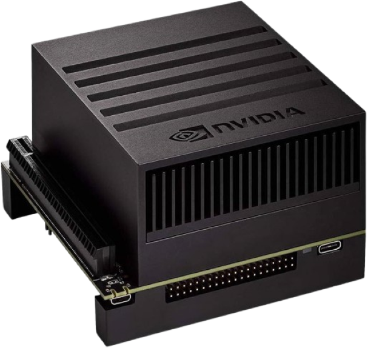](quickstart/nvidia_jetson/jetson_agx_xavier/index.md)

=== "Raspberry Pi"

    **Choose Your Platform**{ .ef-tab-title }

    Select the platform provided by Raspberry Pi.

    **[Raspberry Pi 5](quickstart/raspberrypi/raspberrypi5/index.md)**
    
    [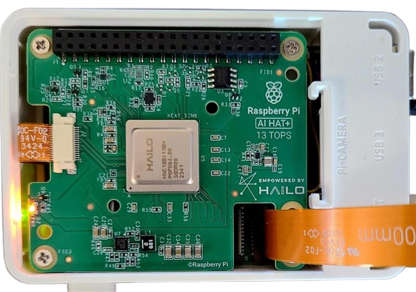](quickstart/raspberrypi/raspberrypi5/index.md)

=== "x86_64"

    **Choose Your OS**{ .ef-tab-title }

    Select the operating system of your machine.
