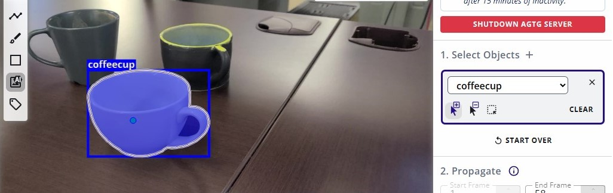
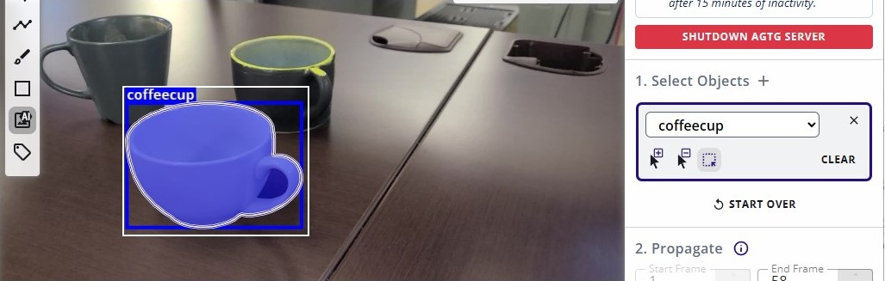
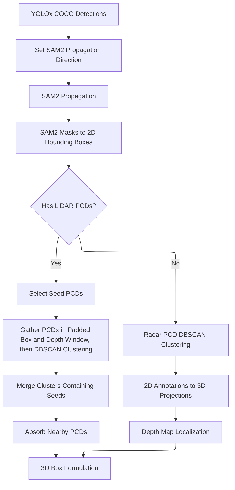

# Automatic Ground Truth Generation (AGTG)

This page is dedicated to describing the Automatic Ground Truth Generation (AGTG) that's available in EdgeFirst Studio.  The context, navigation, and the features of the AGTG will be described here.  For instructions on how to run the AGTG workflow, please see this [tutorial](../datasets/tutorials/annotations/automatic.md).

The AGTG allows datasets to have annotations populated on a dataset with minimal human effort.  The AGTG pipeline is based on driving SAM2 to auto-segment objects throughout the frames.  The segmentation masks generated by SAM are then processed to formulate 2D and 3D (from LiDAR or Radar PCDs) bounding boxes to complete the object's annotations as described in the [EdgeFirst Dataset Format](../datasets/format/schema.md).  There are two modes of operation.

1. *Fully Automatic*: This is invoked at the time of importing the dataset as a background process which deploys a detection model to drive SAM2.
2. *Semi-Automatic*: This is invoked when users trigger the AI assisted annotations in the dataset gallery.  Users can select portions of the dataset to auto-annotate, but SAM2 requires initial annotations from the user as prompts.

A complete annotation set will have 2D and 3D annotations as shown below which is a sample snapshot from the AGTG process.  The 2D annotations are shown on the left which are pixel-based bounding boxes and masks on the image.  The 3D annotations are shown on the right which are world-based 3D boxes surrounding the object in meters.

{{ figure("../datasets/assets/annotations/sample-studio-annotations.jpg", "Sample Annotations") }}

## AGTG App

AGTG is also available as an app in EdgeFirst Studio called "EdgeFirst Studio SAM 2 Server".  The AGTG-App runs a server dedicated to hosting SAM2 for the annotation process.  The server also hosts the AGTG backend, including AutoSAM, which formulates the annotations from the SAM2 results.  The AI assisted annotation tools in the dataset gallery send their requests to this server, so it must be running before annotating.

{{ figure("assets/agtg/agtg-app.png", "AGTG App") }}

## Fully Automatic Ground Truth Generation

This functionality is available at the time of [restoring a snapshot](snapshots.md#restore-snapshot).  To invoke the restore feature, import/create a snapshot and then enable AGTG while restoring the snapshot.  The full tutorial for this workflow is found under [Dataset Annotations](../datasets/tutorials/annotations/automatic.md#fully-automatic-ground-truth-generation).

## Semi-Automatic Ground Truth Generation

This functionality is available after importing the dataset into EdgeFirst Studio.  This type of AGTG requires user annotations in the starting frame to give SAM2 context as to which objects to annotate throughout the rest of the frames.  This section will describe this type of AGTG.  However, the full tutorial for this workflow is found under Dataset Annotations: [2D](../datasets/tutorials/annotations/automatic.md#2d-automatic-ground-truth-generation) or [3D](../datasets/tutorials/annotations/automatic.md#3d-automatic-ground-truth-generation)..

This AGTG feature can be found in the [dataset gallery](datasets/gallery.md).  The dataset gallery can contain sequences or images.

{{ figure("../datasets/assets/management/sample-dataset-sequences.jpg", "Dataset Sequences") }}

{{ figure("../datasets/assets/management/sample-dataset-images.jpg", "Dataset Images") }}

The SAM2 propagation step is only available for sequences.  However, images can still be annotated using SAM2, but through individual annotations which requires more effort over sequences as shown in the [Manual Annotations](../datasets/tutorials/annotations/manual.md#add-2d-annotations).

There are three steps involved in this process: *Initialize AGTG Server*, *Annotate Starting Frame*, *Propagate*.  This AGTG feature can be invoked by clicking on the "AI Segment Tool" button inside the dataset gallery as shown below.

{{ figure("../datasets/assets/annotations/automatic/agtg-segment-tool.jpg", "Select the AI Segment Tool") }}

Clicking on this feature will prompt you to [start an AGTG server](../datasets/tutorials/annotations/automatic.md#initialize-agtg-server).  This is a cloud based server that hosts SAM2 and the AGTG backend.  As indicated, this server will take some time (~3 minutes) to initialize and once initialized, 15 minutes of inactivity will auto-terminate the server.  This is a safety mechanism to prevent extreme usage of the credits available in your account.  As a safety precaution, ensure that all unused servers are terminated to prevent any unnecessary server costs.  When you have finished annotating, click the  button to stop the server.

{{ figure("../datasets/assets/annotations/manual/confirm-agtg-server-launch.jpg", "Launch AGTG Server") }}

Once the AGTG server has been initialized, you can now proceed to the next step which is to [annotate the starting frame](../datasets/tutorials/annotations/automatic.md#annotate-starting-frame) in the sequence.  This will bring the extended sidebar which contains the AGTG features to control the annotation process.  This step is necessary in order to give SAM2 context of the objects to track in the current frame.

Below is a detailed breakdown of the sidebar.

{{ figure("assets/agtg/sidebar.png", "AGTG Sidebar") }}

{{ figure("assets/agtg/agtg-object-card.png", "AGTG Object Card") }}

The number of object cards on the right panel represents the number of objects in the image.  For each object, annotate by either drawing a bounding box (click and drag) around the object or markers (mouse clicks) to specify the region that contains the object.  To draw a bounding box, click anywhere on the frame and then drag the mouse to expand the bounding box.  The bounding box should cover the object to annotate in the frame.

| **Markers** | **Boxes** |
|:-----------:|:---------:|
|  |  |

!!! Note "Multiple Objects"
    Press the "+" button beside the "Select Objects" to add a new object to annotate. Also the object class (label) should be selected from the object label drop down.

The figure below shows multiple instances of coffee cup annotated using the AI assisted annotations as described above.

{{ figure("../datasets/assets/annotations/automatic/agtg-prompts.jpg", "AGTG Initial Prompts") }}

Once the current frame has been annotated, you can move forward to the last step which is to [propagate](../datasets/tutorials/annotations/automatic.md#propagate).  In order to propagate (track) the selected objects in the current frame to subsequent frames, select the ending frames. Please note that the starting frame is fixed to the current frame.  Click "Reverse Propagate" if you require to track objects from current frame to previous frames.

Click the PROPAGATE button for SAM2 to start tracking and annotating the objects throughout the frames.  During propagation, the frame and the counter will update as shown below.  Optionally, you can stop the propagation by clicking the "Stop Propagation" button.

{{ figure("../datasets/assets/annotations/automatic/propagation-process.jpg", "Propagation Process") }}

Once the propagation completes, click on "SAVE AIGT ANNOTATIONS" to save the annotations. The Studio button is labeled AIGT. That is the name shown for AGTG.  This button will save the edited, deleted, or created annotations for this image.  Otherwise, moving to any other image or going to another page will discard the changes.  A completed propagation will show the 2D annotations with masks and 2D bounding boxes for each object across the video frames.  If LiDAR or Radar readings are available in the dataset, the 3D annotations will also be generated.

!!! tip
    For cases where the object exits and then re-enters the frame, the object might not be tracked properly.  Repeat the steps as necessary to annotate the objects that were missed.

## The AGTG Algorithm

The AGTG algorithm is designed to generate the ground truth annotations of a sequential dataset.  The annotations are categorized as image-based 2D annotations and spatial-based 3D annotations.  Image-based annotations are 2D bounding boxes and segmentation masks marking the objects in an image in pixel coordinates.  Spatial-based annotations are 3D bounding boxes around objects in world coordinates such as meters.  More information regarding these annotation types are found [here](../datasets/format/schema.md).

Image-based annotations are generated using Vision models.  A YOLOx ONNX model trained on COCO classes is used as a seed model for example to generate 2D bounding boxes.  The large [SAM2 PyTorch model](https://github.com/facebookresearch/sam2) is used to generate 2D segmentation masks from the 2D bounding boxes generated by the Vision model. The AGTG tool takes advantage of the SAM2's object tracking and propagation capabilities to auto-annotate throughout the frames in the dataset.

Spatial-based annotations are generated using sensor information such as the LiDAR and Radar and model predictions such as the 2D annotations (bounding boxes and masks) and depth estimations from a large ONNX depth model from [Metrics3D](https://github.com/YvanYin/Metric3D).  These annotations will be generated for recordings captured using the Raivin with either a Radar or a LiDAR module attached.

The AGTG Algorithm can be visualized using the following flow chart.

The logic shown starts with object detection using the YOLOx model.  These detections are used to drive the SAM2 propagation which relies on the input frames and bounding box prompts around the objects in these frames.  The segmentation masks are then converted into an array of polygons and a 2D bounding box is formulated for each mask completing the set of 2D annotations.

The spatial-based annotations are formulated based on one of the following sensors and 2D annotation combinations.

1. Radar Point Clouds + Depth map Estimations + Segmentation Masks
2. LiDAR Points Clouds + Segmentation Masks

For Raivin recordings without the LiDAR PCDs, the first combination is applied to formulate 3D bounding box annotations using Radar PCDs instead.  This process applies a DBSCAN clustering algorithm to the Radar PCDs to cluster groups of points belonging to a single object.  Next the process intends to find the Radar PCD cluster that corresponds to the object that is segmented in the image.  The logic here is to project the 2D bounding box into world coordinates and to take the depth estimations enclosed by the segmentation mask to find the nearest distance between the (x, y) coordinates and the cluster’s centroid.  The cluster with the smallest distance from the estimated coordinates is the PCD cluster that represents the object.  The 3D bounding box is formulated by taking the x, y, z center coordinates (centroid) of the cluster and the depth, width, height of the bounding box are taken from both the 2D image projections and the dimensions of the cluster.

For Raivin recordings with the LiDAR module, the second combination is applied to formulate the 3D bounding box annotations using a seed-and-grow approach.  The segmentation mask alone is not used to crop the PCDs because the mask can truncate the object, for example where the mask edge is slightly inside the object or the object is partly occluded.  Instead, the mask only selects the starting points (seeds) and the 3D box is grown from them.

1. **Select seeds**: The LiDAR PCDs that project inside the segmentation mask are the seeds.  If no PCD intersects the mask, or no mask is available, the PCDs that project inside the 2D bounding box are used instead.
2. **Estimate the object depth**: The median x (forward distance) of the seeds is taken as the depth of the object.  The median is robust to a few seeds that belong to the background.
3. **Gather candidates**: From the whole point cloud, the PCDs that project inside the 2D bounding box dilated by a padding (15% per side by default) and that are within a depth window around the median depth (±1 m by default) are collected.  Seeds are always included.
4. **Cluster**: A DBSCAN clustering algorithm is applied to the candidates to group the PCDs that belong to the same surface.
5. **Merge seeded clusters**: Every cluster that contains at least one seed is merged into the object.  The clusters are selected by their seeds, not by their size, so a large background cluster inside the padded box is not chosen over a smaller cluster on the segmented object.
6. **Grow**: Any candidate PCD, including the points DBSCAN left unclustered as noise, that lies within a margin (0.3 m by default) of the merged cluster's extents is absorbed.  This keeps sparse returns on the edge of the object inside the box.
7. **Build the box**: The 3D bounding box is formulated from the full extents of the merged cluster.  The center is the middle of the extents and the depth, width, and height are the size of the extents.

!!! note
    The padding, depth window, and grow margin only affect which PCDs can join the object.  The padded box and depth window limit the candidates, so a PCD outside of them is never included in the 3D box regardless of the grow margin.

### AutoSAM Settings

AutoSAM is a dependency of the AGTG-App that performs the auto-annotation and formulates the 3D bounding boxes.  AutoSAM itself depends on a fork of the SAM2 library.

The following settings control the LiDAR 3D box formulation in AutoSAM.  They are defined in the `Config` class.

| Setting | Default | Description |
|---------|---------|-------------|
| `LIDAR_INTERSECTION` | `"mask"` | Selects which PCDs are the seeds.  `"mask"` seeds from the PCDs inside the segmentation mask and falls back to the 2D box when none intersect.  `"box"` seeds from the PCDs inside the 2D box only. |
| `LIDAR_BOX_PADDING` | `0.15` | Fraction of the 2D box width and height added to each side when gathering candidate PCDs.  This is measured in image space, so the distance it covers depends on how far the object is. |
| `LIDAR_DEPTH_WINDOW` | `1.0` | Distance in meters around the median seed depth within which candidate PCDs are kept. |
| `LIDAR_GROW_MARGIN` | `0.3` | Distance in meters around the merged cluster's extents within which extra PCDs, including unclustered ones, are absorbed into the 3D box. |

The DBSCAN clustering parameters for the LiDAR PCDs are fixed in AutoSAM and are not configurable.

| Parameter | Value | Description |
|-----------|-------|-------------|
| Clustering epsilon | `0.25` | Maximum scaled distance between neighbouring PCDs of the same cluster. |
| Parameter scale | `[2, 0.5, 0.5, 0]` | Scale applied to the x, y, z, and extra fields before computing distances.  Gaps along x are weighted more than gaps along y and z. |
| Minimum points | `4` | Minimum number of PCDs to form a cluster.  Groups with fewer points are treated as noise. |

If PCDs of the object are still left outside of the 3D box, increase `LIDAR_GROW_MARGIN` first.  If the object is large or its PCDs are far from the 2D box, increase `LIDAR_BOX_PADDING` or `LIDAR_DEPTH_WINDOW`.  Larger values risk including background PCDs in the box.

## Next Steps

Now that you have been introduced to the auto-annotation features in EdgeFirst Studio, see the [Datasets](../datasets/index.md) section to learn more about managing your own datasets from following the capture and annotation workflows. Otherwise, proceed to the [Model Experiments Dashboard](models.md) to learn more about the context of model training and validation.
